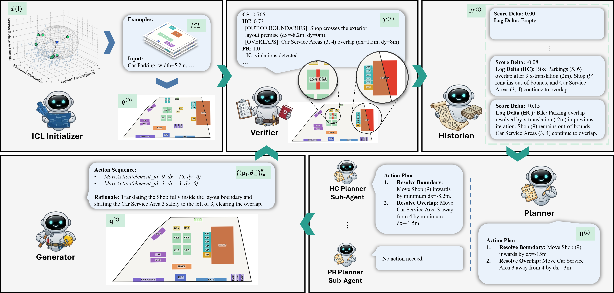
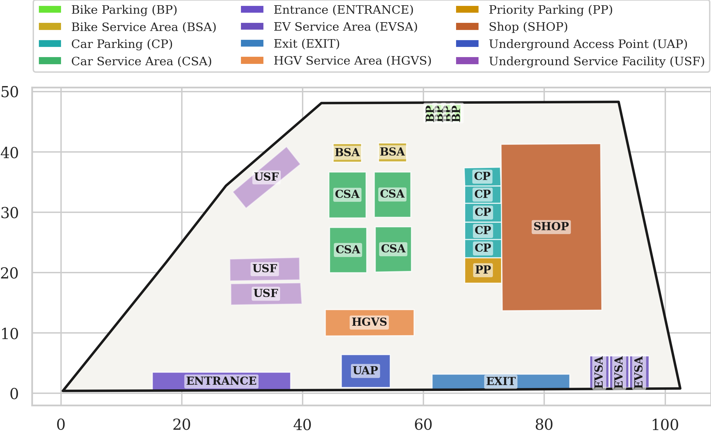
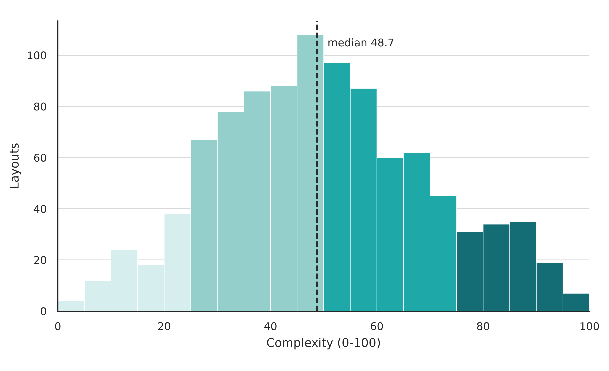
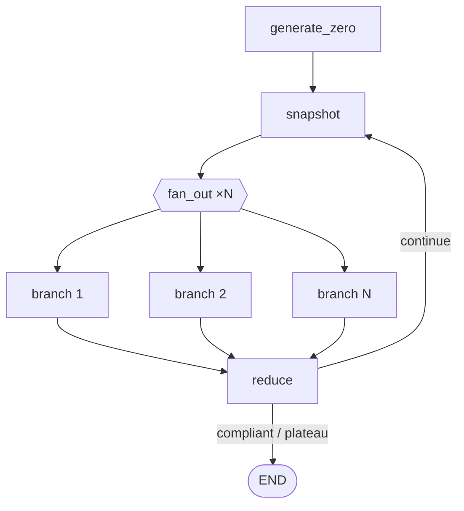
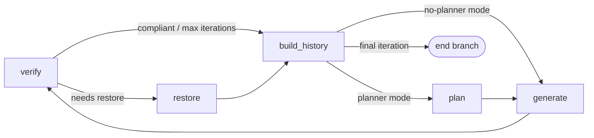

<p align="center">
  
</p>

<h1 align="center">CANDO: Cooperative Agentic Network for Layout Design Optimization</h1>
<p align="center"><strong></strong></p>
<h3 align="center"><b>NeurIPS 2026</b></h3>

<p align="center">
  Athanasios Masouris &middot; Jing Zheng &middot; Benjamin Chandler &middot; Hadi Jamali-Rad
</p>

<p align="center">
  
  <a href="https://arxiv.org/abs/2610.10044"></a>
  <a href="https://github.com/Shell-OSS/cando/tree/main/data"></a>
  <a href="https://shell-oss.github.io/cando/"></a>
</p>

<p align="center">
  
</p>

## Abstract

Layout generation for real-world facilities is a challenging problem, requiring reasoning over irregular site boundaries, heterogeneous orientations, access-aware placements, and motion-planning feasibility. Yet, most existing layout benchmarks in the generative AI space target simpler placements over rectangular domains and rely on distributional metrics such as FID and IoU that reward conformity to dataset priors, thus discounting design innovation. Motivated by these gaps, we introduce **ALPS-Bench**, a benchmark of 1,000 professionally annotated real-world facility layouts paired with an instance-specific scoring protocol grounded in a structured design manual. As a strong baseline for **ALPS-Bench**, we propose **CANDO**, a training-free multi-agent framework in which specialized agents iteratively refine layouts through a verification-grounded loop, concentrating reasoning on strategic spatial decisions. We demonstrate that **CANDO** surpasses state-of-the-art trained and LLM-based baselines on the widely adopted **PubLayNet**, **RICO**, and **PKU-PosterLayout** benchmarks, establishing cooperative agentic design as a broadly effective recipe for constraint-aware layout synthesis.

## ALPS-Bench

Asset Layout Planning and Synthesis Benchmark (ALPS-Bench) contains 1,000 layouts from real operational sites, annotated at the polygon level by professional annotators working from CAD drawings; released geometries are anonymized. Each layout pairs a site boundary with a record of design requirements drawn from 14 semantic classes spanning access points, service infrastructure, buildings, and parking. The released split keeps full annotations for 900 development layouts (further split into 800-sample training and 100-sample validation sets) and withholds ground truth for the other 100, which form the test set used for standardized evaluation. Site premises range from about 390 to 19,359 square meters and contain between 7 and 101 annotated polygons, so both the footprint and the composition of a facility vary considerably across the benchmark — entrances and exits appear in every layout, for instance, while EV service areas and specialized parking are present in only a minority of sites.

<p align="center">
  <a href="docs/assets/img/layout.png"></a>
  <a href="docs/assets/img/complexity_distribution.png"></a>
</p>

Generated layouts are scored with an instance-specific protocol rather than distributional similarity to the training set. Hard requirements check that specified elements exist, stay within the boundary, avoid overlap, and admit feasible vehicle routes verified with Voronoi-based motion planning; soft requirements check proximity, grouping, and orientation rules drawn from a shared design manual. Routing efficiency is additionally compared against the withheld reference layout in terms of path length, turns, and clearance, and invalid layouts are penalized in the aggregate score used for ranking.

## Results

The table below reports performance on the ALPS-Bench test set (100 held-out layouts), following the blockwise sampling procedure adapted from CoDe. **AGG** aggregates constraint satisfaction (**CS**) and routing efficiency (**RE**); **T** is the refinement-step budget for that method, and **Compliance** is the share of layouts satisfying every hard constraint. `†` marks methods trained or fine-tuned on ALPS-Bench; all others are training-free with respect to it. Full statistical testing and results on PubLayNet, RICO, and PKU-PosterLayout are reported in the paper.

| Method | AGG ↑ | CS ↑ | RE ↑ | T | Compliance (%) |
| --- | --- | --- | --- | --- | --- |
| Qwen-LoRA-ALPS † | 0.07 | 0.01 | 0.13 | 1 | — |
| LayoutDM † | 0.13 | 0.01 | 0.24 | — | — |
| LayoutPrompter (GPT-5.2) | 0.17 | 0.01 | 0.33 | 1 | — |
| LayoutCoT (GPT-5.2) | 0.19 | 0.13 | 0.25 | 4 | — |
| Single-Agent (GPT-5.2) | 0.40 | 0.47 | 0.32 | 200 | 22.4 |
| CANDO (BoN / GPT-5.2) | 0.59 | 0.77 | 0.41 | 20 | 60.6 |
| CANDO (CoDe / GPT-5.2) | 0.60 | 0.78 | **0.42** | 20 | 63.6 |
| CANDO (CoDe / Qwen3.6) | **0.62** | **0.83** | 0.41 | 20 | **74.0** |

## Architecture

CANDO is implemented as a LangGraph state graph. GeneratorZero retrieves similar exemplars and proposes the initial layout; `snapshot` then checkpoints the state before fanning out to `N` parallel branches, each refining the layout independently for a fixed number of steps, before `reduce` keeps the best-performing branch and either loops back for another round or ends the run.



Within a branch, the Verifier scores the current layout against the design manual; the Historian summarizes recent progress; the Planner prioritizes the highest-impact fixes (skipped entirely in the no-planner ablation); and the Generator executes them before handing back to the Verifier.



## Getting started

**Requirements:** Python 3.13.6 (or a later 3.13 release), [uv](https://docs.astral.sh/uv/), model-provider credentials, and the ALPS-Bench data and retrieval artifacts. Running the agents calls a model provider and may incur API charges.

```bash
git clone https://github.com/Shell-OSS/cando.git
cd cando
uv sync
cp .env.example .env
```

Edit `.env` to set `CANDO_MODEL_ID` and credentials for that provider (Azure OpenAI by default). Set `DATASET_JSONL_PATH` to the **training layouts** JSONL (`train.jsonl`, full polygons), `FEATURE_VECTORS_PARQUET_PATH` to its feature vectors (matched by layout id), and `SCALER_CONFIG_PATH` to the matching scaler JSON. The checked-in [`.env.example`](.env.example) describes these settings.

Download the dataset and retrieval artifacts from the **ALPS-Bench dataset** link above. If you need to recompute feature vectors and a scaler, run `scripts/extract_exemplar_features.py` against the **training constraints** JSONL (`train_constraints.jsonl`, the same input format used at inference) and use its generated artifacts in `.env`.

Run one sample from the downloaded test constraints:

```bash
uv run python scripts/run_graph.py /path/to/test_constraints.jsonl \
  --sample-index 0 \
  --max-iterations 20 \
  --output-dir logs/demo
```

The best layout, rendered PNG, run summary, and iteration history are written to `logs/demo/`. For repeated evaluation over a test split:

```bash
uv run python scripts/run_eval.py /path/to/test_constraints.jsonl \
  --n-reps 1 --n-workers 1 --output-dir logs/evaluation
```

Use `uv run python scripts/run_graph.py --help` and `uv run python scripts/run_eval.py --help` for the full set of refinement, branching, and ablation options.

## Repository layout

| Path | Purpose |
| --- | --- |
| [`src/cando/`](src/cando/) | Agent implementations, refinement graph, verification, and scoring |
| [`scripts/`](scripts/) | Generation, evaluation, and feature extraction entry points |
| [`tests/`](tests/) | Automated tests |
| [`docs/assets/img/`](docs/assets/img/) | Publication figures shared by the README and project website |

## Citation

If you use CANDO or ALPS-Bench, please cite the paper. The BibTeX entry will be added here once the NeurIPS 2026 proceedings are published.

## License

The repository code is released under the [Apache 2.0 License](LICENSE). Third-party attributions are listed in [NOTICE](NOTICE).
