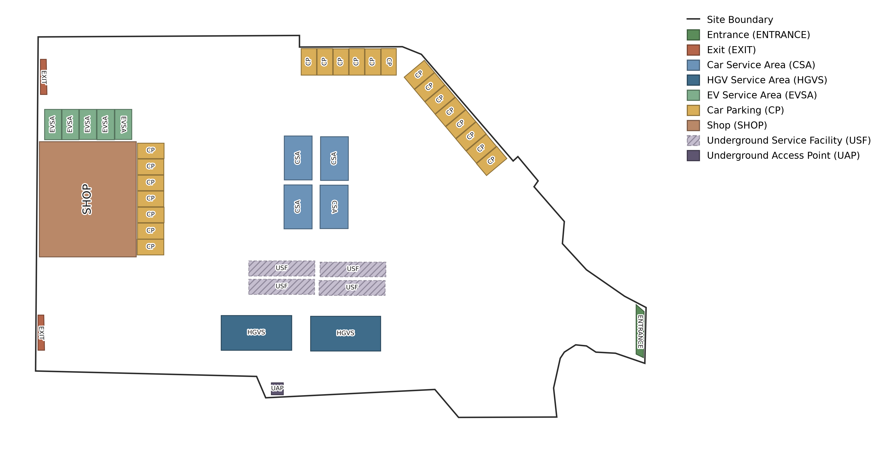

# ALPS-Bench

<p align="center">
  
</p>

<p align="center"><sub>Example layout from <code>sample_images/</code>: site boundary, access points, and placed elements, with the class legend.</sub></p>

ALPS-Bench (Asset Layout Planning & Synthesis) is a benchmark of 1,000 real-world facility layouts. Annotators traced each layout from the original CAD drawing of an operational site. Layouts are scored by compliance with a design manual (hard and soft constraints, plus routing feasibility), not by similarity to a reference.

- 14 semantic classes: the site boundary (`Layout Polygon`), `Entrance`, `Exit`, service areas, parking bays, `Shop`, and underground facilities.
- Premise area 390 – 19,359 m², 7 – 101 elements per layout.
- Task: given the premise, its access points, and a list of elements with fixed shapes, place every element by choosing a position and an orientation.


## Splits

| Split | Layouts | Contents |
| --- | --- | --- |
| `train` | 800 | Full annotations, plus augmented copies |
| `val` | 100 | Full annotations |
| `test` | 100 | Input requirements only; ground truth is hidden and used for evaluation on a hosted server |

`train` and `val` together form the development set (900 layouts with ground truth).

## Layout

```
data/
├── sample_images/   # PNG renderings of example layouts
├── train/
│   ├── train.jsonl                       # 800 annotated layouts
│   ├── train_constraints.jsonl           # 800 inputs (premise, access points, element sizes)
│   ├── train_augmented.jsonl             # 6,400 augmented layouts (8 per layout)
│   ├── train_augmented_constraints.jsonl # inputs of the augmented layouts
│   └── train_manifest.jsonl              # augmented id -> parent id and augmentation
├── val/
│   ├── val.jsonl                         # 100 annotated layouts
│   └── val_constraints.jsonl             # 100 inputs
└── test/
    └── test_constraints.jsonl            # 100 inputs
```

## Format

Each line is a JSON object with an `id` and a list of `elements`.

- Annotated layouts (`*.jsonl`): every element has an `id`, a `class`, and a `polygon` (list of `[x, y]` vertices in metres).
- Constraint files (`*_constraints.jsonl`): the task input. `Layout Polygon`, `Entrance`, and `Exit` keep their `polygon`. All other elements give only `class`, `width`, and `height`, and must be placed by the solver.
- `train_manifest.jsonl`: `augmentation` is one of `identity`, `rotate_90_ccw`, `rotate_180`, `rotate_270_ccw`, `flip_horizontal`, `flip_vertical`, `reflect_main_diagonal`, `reflect_anti_diagonal`.

## Usage

Reading a split:

```python
import json

with open("data/val/val.jsonl") as f:
    layouts = [json.loads(line) for line in f]
```

Visualizing layouts with [`scripts/visualize_layouts.py`](../scripts/visualize_layouts.py), run from the repository root:

```bash
# Show the first two layouts of the validation split
uv run python scripts/visualize_layouts.py --index 0 1

# Select by id (a unique prefix is enough) and save to ./visualizations/
uv run python scripts/visualize_layouts.py --id 2a9d53a4 --save

# Rows 0-9 and 20 of the train split, saved to a custom folder
uv run python scripts/visualize_layouts.py --split train --index 0-9 20 --save out/

# Five random augmented training layouts
uv run python scripts/visualize_layouts.py --augmented --random 5 --save
```

| Option | Description |
| --- | --- |
| `--id ID [ID ...]` | Layout id(s) or unique id prefixes; searches all splits unless `--split` is set |
| `--index N [N ...]` | 0-based row indices within the split; ranges such as `3-7` are allowed |
| `--random N`, `--seed S` | N random layouts from the split |
| `--all` | Every layout of the split |
| `--split {train,val,test}` | Split for `--index`, `--random`, `--all` (default `val`) |
| `--augmented` | Use the augmented training layouts |
| `--show` | Open the layouts in a window (default when `--save` is not given; at most 10) |
| `--save [PATH]` | Write PNGs to a folder, created if needed (default `./visualizations/`) |
| `--dpi D` | Image resolution (default 300) |

Layouts of the `test` split only contain the task input, so just the premise and the entrance/exit are drawn.
